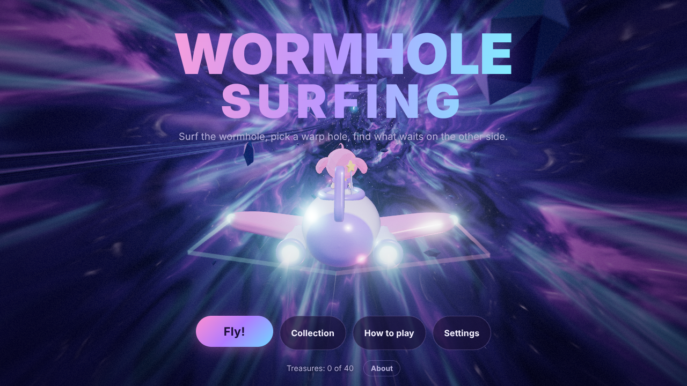
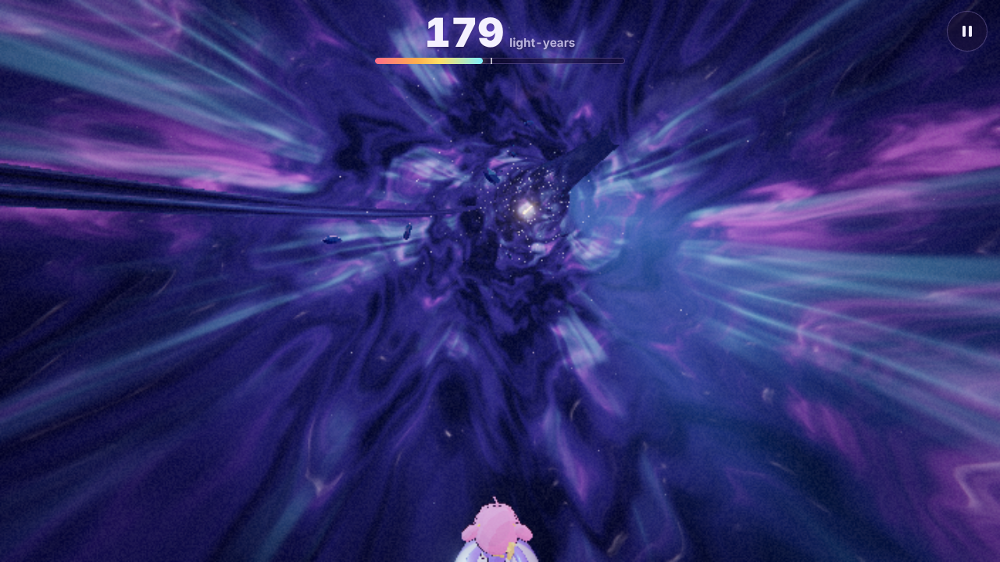
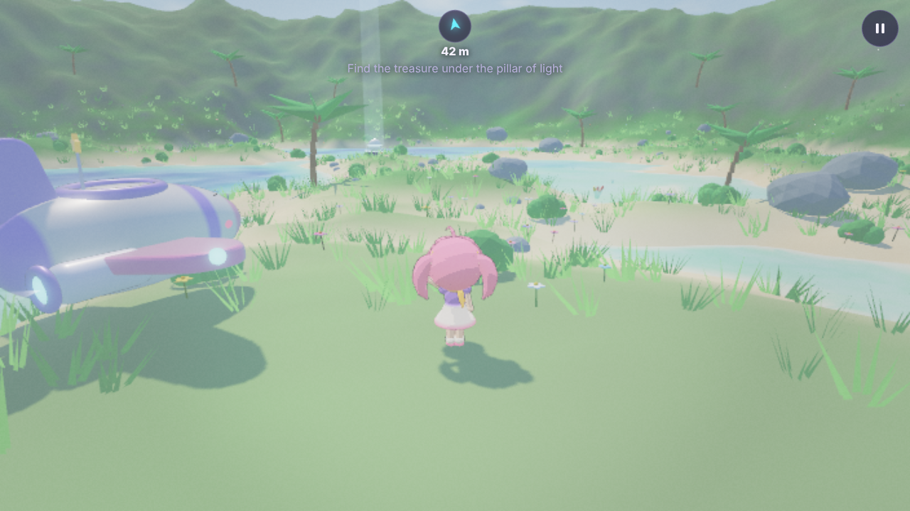
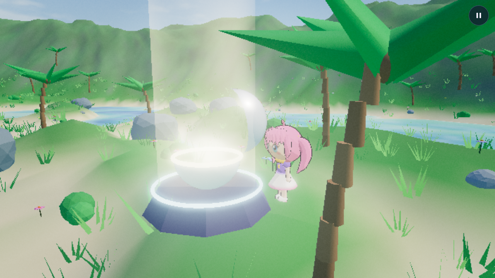
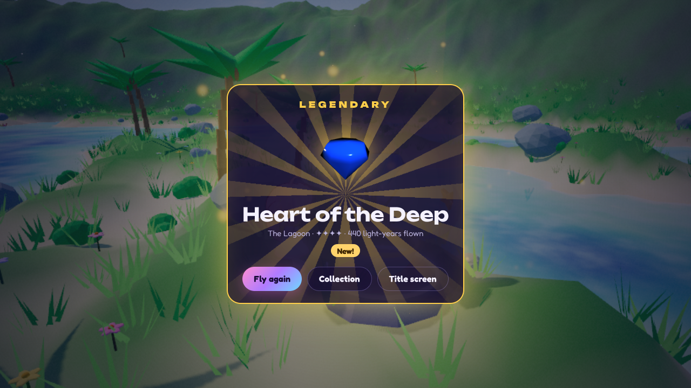

# Wormhole Surfing

[](https://github.com/FionaPreroll/vibe-wormholesurfing/actions/workflows/ci.yml)
[](https://codecov.io/gh/FionaPreroll/vibe-wormholesurfing)
[](https://github.com/FionaPreroll/vibe-wormholesurfing/actions/workflows/android.yml)

Ride a cute spaceship through a swirling wormhole, pick a warp hole, and see what waits on the other side. A browser game in 3D: the ride takes the mechanics of a classic warp ride, collect orbs for speed, dodge sparks, and choose a hole before a hole chooses you, and then lets a chibi girl explore the world behind it and open the treasure that waits there.

Everything is made in code: the ship, the girl, the eight worlds, the music and every sound. There are no image, model or sound files.



## Screenshots

|                                                                  |                                                                   |
| ---------------------------------------------------------------- | ----------------------------------------------------------------- |
|       |               |
| The ride: light-years flown, speed, orbs, sparks and warp holes. | A world behind a hole, with the compass pointing to the treasure. |
|           |                |
| The star capsule opens in the light of the treasure's rarity.    | What it held, how rare it is and whether it is new.               |

`pnpm screenshots` takes these pictures again (see [Updating the screenshots](#updating-the-screenshots)).

## How to play

- **Ride.** The ship flies on by itself; you steer it across the tunnel. Golden orbs give speed, and a quick chain of them gives more. Blue sparks stun the ship for a moment and cost speed. The counter at the top shows the light-years flown.
- **Warp holes.** Holes come toward you in five colors. Fly into one to end the ride there. Rarer holes appear more often the farther you fly, up to 5,000 light-years: a plain hole, a hole with one golden halo, with two halos, and with two halos and a flower-shaped aura.
- **Gravity.** Below a certain speed the holes pull at the ship, harder the slower it is; the line on the speed bar marks the safe speed. Too slow, and the next hole takes the ship in whatever you do. So the ride ends either where you choose or where the wormhole chooses.
- **Worlds.** Red holes lead to the Cliffs, blue ones to the Lagoon, green ones to the Canyon and yellow ones to the Caverns. White holes lead to four strange worlds: the Crystal Sea and the Star Dunes, the rarer Floating Gardens and the rarest, the Aurora Void.
- **Treasure.** In the world, walk to the pillar of light; the compass at the top points there. Open the star capsule and see what it holds. Each world has five treasures, from common to legendary; rarer holes and longer rides make rarer ones likelier, and the chance of a shiny one grows with the distance. A flower-aura hole always holds the world's legendary treasure until you have found it.
- **Collection.** Every treasure found stays in the collection, with how often it was found and whether a shiny one was among them.
- **Sharing.** The collection's Share button draws a 1200 × 630 picture of every world's five treasures with the numbers worth bragging about (`src/ui/share.ts`) and hands it with a text and the game's address to the device's share sheet; without one, it saves the picture and copies the text.
- **HUD.** A cockpit panel in the corner shows the ship's speed on a gauge (with the safe speed marked and the pull of holes on an inner arc) and the orbs, sparks, time and farthest ride on seven-segment LCDs drawn in SVG (`src/ui/lcd.tsx`); in a world, the world, the hole's tier, the light-years flown and how near the treasure is. Settings → Display scales the HUD from 0.2 to 4 times and the dialogs and the treasure card from 0.5 to 2 times, with CSS `zoom` (`--hud-scale` and `--menu-scale` on the page): each panel of the HUD grows from its own corner, the touch sticks stay out of it, and a dialog's bounds in viewport units are divided by its scale so it still fits the screen.
- **Water.** Shallow water is waded through; deeper water is swum through, the girl floating with her head above the surface (`floorAt` in `src/core/land.ts`). Only the edge of the world stops her. The treasure capsule's pedestal is solid.

### Controls

|            | Ride                                                           | World                                                                                  | Menus                                                  |
| ---------- | -------------------------------------------------------------- | -------------------------------------------------------------------------------------- | ------------------------------------------------------ |
| Keyboard   | WASD or arrow keys                                             | WASD to walk, Space to jump, E or Enter to open, arrow keys or IJKL to turn the camera | Tab, Enter, Escape                                     |
| Mouse      | The pointer steers: the middle of the screen is straight ahead | Drag to turn the camera, wheel to zoom                                                 | Click                                                  |
| Controller | Left stick or D-pad, Y centers the tilt                        | Left stick walks, right stick looks, A jumps or opens, X opens, LB/RB zoom             | D-pad or stick moves the focus, A chooses, B goes back |
| Touch      | A finger anywhere is a stick under that finger                 | Left thumb walks, right thumb looks, buttons jump and open                             | Tap                                                    |
| Tilt       | Tilt or turn the device the way to fly                         | –                                                                                      | –                                                      |

Escape, P or the controller's Start pauses; the pause menu also centers the tilt. Whichever way to play was used last steers, so picking up a controller or touching the screen just works.

These are the defaults. **Settings → Controller and keys** binds two keys and two controller buttons to every action (`src/input/bindings.ts`): a key or button moves from where it was, so one press never does two things, except that a direction may steer and turn the camera alike, as the arrow keys do (they steer in flight and turn the camera on foot). The same dialog swaps the sticks and tunes each one: how strongly it answers, the size of its dead zone, and its shape (`shapeStick` in `src/input/stick.ts`): round, the same in every direction; cross, each axis on its own, so a lean that is nearly straight comes out straight; or square, where the slightest push along one axis counts. A picture of each stick shows the dead zone, where the stick leans and what the game gets. The menus always take the D-pad, the left stick, A and B, so no binding can lock a player out. The arrow keys move the focus as the D-pad does (`watchMenuKeys` in `src/input/menuNav.ts`). As browsers ring the focus (`:focus-visible`) only after keys, not when a controller moves it or after a click, the menus mark the page with `data-focus` while a controller or the keys work them, and a press of the mouse or a finger takes the mark away. In the Controller and keys dialog the sticks are being tried out, so only the D-pad moves the focus there (`data-sticks="free"`). The camera's up and down can be inverted in the settings, apart from the ship's.

Buttons are named as the controller in hand prints them: the browser's name for it gives the maker (Sony's USB vendor 054c, Nintendo's 057e), so a PlayStation controller shows ✕ ○ □ △, L1 and R2, a Nintendo one its swapped letters, others Xbox letters (`src/ui/controlNames.ts`). Keys are named as the keyboard's layout prints them where the browser tells it (Chrome's `navigator.keyboard.getLayoutMap()`), so a German keyboard shows Z where a US one has Y. The hints in the ride and the world name the keys and buttons as bound.

Tilt steering is off until it is switched on in the settings. It steers relative to how the device is held when it is switched on, when a ride starts, or when **Center tilt** is pressed; turning the device like a steering wheel or like a window to look through both steer sideways, tipping it steers up and down. On iPhones and iPads the browser asks for permission when it is switched on.

## Getting started

You need Node.js 22.12 or newer (CI uses Node 24) and pnpm. `package.json` pins pnpm 12.15.0, and pnpm 10 or newer switches to that version by itself.

```sh
pnpm install
pnpm dev
```

`pnpm dev` serves the game at http://localhost:5173 and reloads on every change. Add `?debug` to the address to get `window.wormhole`, a handle on the 3D view that the browser tests use to drive the game.

## Scripts

| Script                         | What it does                                                                          |
| ------------------------------ | ------------------------------------------------------------------------------------- |
| `pnpm dev`                     | Development server with hot reload                                                    |
| `pnpm build`                   | Production build into `dist/`                                                         |
| `pnpm preview`                 | Serves `dist/` locally                                                                |
| `pnpm check`                   | Type check, lint and unit tests; run it before every push                             |
| `pnpm typecheck`               | TypeScript for `src/core` (without DOM types), the app, and the config and test files |
| `pnpm lint`, `pnpm format`     | Biome: check lint and formatting, or fix both                                         |
| `pnpm test`, `pnpm test:watch` | Vitest unit tests                                                                     |
| `pnpm test:coverage`           | Unit tests with a coverage report in `coverage/`                                      |
| `pnpm test:e2e`                | Builds, then runs the Playwright browser tests                                        |
| `pnpm icons`                   | Renders the app icons in `public/icons/` from `public/favicon.svg` with Chromium      |
| `pnpm screenshots`             | Builds, then takes the README's screenshots into `docs/screenshots/` with Playwright  |

Playwright needs a Chromium: run `pnpm exec playwright install chromium` once, or set `CHROMIUM_PATH` to an installed Chromium binary.

## Stack

TypeScript 7, three.js for the 3D view, Preact with Signals for the interface around it, Vite 8, Vitest 5, Playwright, Biome 2 and Zod. It is the stack of [Vibe Laser](https://github.com/FionaPreroll/vibe-laser), with three.js in place of PixiJS, since this game is 3D.

The fonts are [Unbounded](https://github.com/googlefonts/unbounded), wide and bold, for the logo and headings, and [Fredoka](https://github.com/hafontia/Fredoka-One), rounded and easy to read, for everything else, both under the SIL Open Font License and installed from [Fontsource](https://fontsource.org/). `src/ui/fonts.ts` loads only their Latin letters, which German needs too (about 80 KB), and the collection's share picture draws with them. They are the only files the game brings that code did not make.

The first download holds the menus only. The 3D view, with three.js, loads on demand (`src/ui/App.tsx` imports `src/view/director.ts` with `import()`), so the title screen shows at once; the service worker keeps both for later visits.

## Project layout

```
src/
  core/         game rules in pure TypeScript: no DOM, three.js or Preact
  game/         settings, what the HUD shows, and the events sound and buzzes follow
  input/        keyboard, mouse, controllers, touch sticks and tilt, as one set of controls
  view/         three.js: the engine, the ride, the worlds, the ship, the girl and the treasures
  audio/        sound effects, ambience and music, synthesized with Web Audio
  persistence/  the save in IndexedDB
  i18n/         English and German texts, t() and the language setting
  ui/           Preact screens, HUD and dialogs over the 3D view
  main.tsx      entry point
tools/          Vite plugins for the service worker and the list of lazy files, the icon renderer
tests/e2e/      Playwright browser tests
tests/screenshots/  the README's screenshots
public/         static files, copied as they are
```

Two rules keep the layers apart:

- `src/core` imports nothing from outside `src/core`. Its own `tsconfig.core.json` has no DOM types, and Biome blocks imports of three.js, Preact and other `src/` folders there.
- Every text players see goes through `t()` from `src/i18n`, in English and German. The German catalog is typed against the English one, so a missing text fails the type check.

## Rules

- **The ride** (`src/core/ride.ts`) is a fixed-step simulation at 120 steps a second. Space is a straight tunnel: the ship moves across a disc of its cross-section, and orbs, sparks and holes come toward it. The view bends the tunnel for the eye only (`src/view/ride/bend.ts`): things ahead are pushed aside by an offset that grows with the square of their distance, so the way ahead curves while the ship's surroundings stay straight. A ride is the same for the same seed and steering.
- **Speed** starts at 1.2 and falls a little every second, more the farther the ride has gone. Orbs add speed, and chains of orbs within 1.4 seconds add more; sparks take speed and stun the ship. Orbs grow scarce with distance and stop at 6,000 light-years, so every ride ends.
- **Pull.** Below speed 1.2 holes within reach pull at the ship, harder the slower it is and the closer the hole. Below 0.55 the next hole captures the ship, and if none is near, one appears in its way.
- **Hole tiers** (`src/core/holes.ts`) come from a table of odds by distance that blends smoothly between 0 and 5,000 light-years. Colored holes are equally likely, white ones a little rarer.
- **Worlds** (`src/core/worlds.ts`): a colored hole leads to its world, a white hole to one of the strange worlds, rare ones more often in rare holes.
- **Treasures** (`src/core/rewards.ts`): each world has five, one of each rarity. A hole's tier sets the odds of each rarity, and distance shifts them further toward rare finds. The chance of a shiny treasure rises from 1 in 48 to 1 in 12 over 5,000 light-years. A flower-aura hole holds the legendary treasure of its world until it has been found once.
- **Expeditions** (`src/core/expedition.ts`): the world's ground (`land.ts`), its scenery (`scatter.ts`) and the treasure come from the arrival's seed. The treasure is placed only where a search over the ground finds a way to walk from the landing site. Of the places it can go, open ones come first (`enclosure` in `src/core/framing.ts`: how much of the ground around rises steeply), and one is taken only if the camera can watch the treasure open from at least four of eight sides: the line of sight stays clear of the ground and of scenery (`clearView`). When it opens, `revealView` frames the girl and the treasure from the side nearer the camera, or turns to a clear side, or rises over what is in the way, instead of pushing into a wall. The girl on foot (`walker.ts`) walks relative to the camera, jumps, follows the ground, slows on steep slopes and stays out of rocks, deep water and the edge of the world.

## The 3D view

- Changing the canvas's size clears it, and a browser that shows the page before the next frame is drawn shows it black. So the engine never resizes the canvas between frames: a resize waits for the next frame and happens right before it is drawn. A resolution the engine had to lower holds for 20 seconds before it tries a higher one again, so it does not swing up and down.
- `Engine` (`src/view/engine.ts`) draws the current stage through a chain of passes: the scene in half-float color with multisampling, a pass that bounds every pixel and blacks out broken ones (found by their bits, as infinity and NaN have every exponent bit set: Direct3D's compiler on Windows assumes no float is NaN and drops `isnan()`) (on real graphics chips a glossy highlight can overflow half floats to infinity, which bloom would otherwise smear across the whole screen as black), bloom, a finishing pass with color fringes, speed blur, vignette, flashes and film grain, and tone mapping. It lowers the resolution while frames come late and raises it again once they are on time, so phones and the MacBook Air hold their frame rate. Each step down is a trial (`src/view/resolution.ts`): if frames do not come at least a tenth quicker within three seconds, the time goes elsewhere, as to the browser's own work on a phone, so the resolution goes back up and stays at least there on that screen, instead of blurring the picture for nothing.
- **Entering a world without a stall.** The ride says when the ship enters a hole (`onEnter`), 1.8 seconds before it arrives: the outcome is settled then, so the director makes the world ready during the warp, in steps a frame apart (`src/view/director.ts`): the world's rules, the ground in bands of a few thousand vertices (`buildTerrainInSteps`), the sky's reflections (`src/view/environments.ts`), the rest of the stage. Then `Engine.prepare` compiles its shaders: with `KHR_parallel_shader_compile` all at once alongside the frames (`compileAsync`), without it a few objects a frame, each new program finished at once; either way with the composer's buffer bound, as the scene draws into it and not to the screen, or the first frame would build them all again. At arrival, while the warp's light holds the screen white, `Engine.warmUp` draws the world once with nothing culled, so geometry and textures go to the graphics chip and drivers that build pipelines at a first draw do so then; the world shows after. Leaving the ride meanwhile drops the world. The renderer keeps one reflection generator, so its blur shaders compile once, and the ride's space reflections are made once; the girl's outline material, which every stage shares, is never disposed by a stage. The debug log notes each world's build (`longestStep`), compile and warm-up times. Title screens and rides compile the same way before they show (`showWhenReady` in `src/view/director.ts`), while the stage before goes on: three.js frees a program once no material uses it, so a stage shown at once built again, in its first frame, every program the stage before had just let go (18 at every start of a ride, a tenth of a second on Windows), and the very first title screen built all of them in one frame (2.3 seconds on an RTX 4070 under Direct3D). A ride's stage also holds an orb, a spark and the rarest hole, hidden, so their shaders compile with it and stay alive for the ones that come later; and the passes after the scene compile ahead too (`#compilePasses` in `src/view/engine.ts`), with a buffer bound and on a quad of positions and texture coordinates only, as both decide how a program is built.
- **Quality** (`src/view/quality.ts`): Automatic picks High on computers, Medium on phones and tablets, and Low where WebGL runs in software, as in the browser tests. The levels set the highest pixel ratio, multisampling, shadows and how many particles, crystals and plants are drawn. Only High and Ultra draw the panels and buttons as frosted glass: below them, `data-glass="flat"` on the page turns the blur off (`--glass-blur` in `src/ui/styles.css`), as a phone's browser blurs the moving 3D view behind every panel again each frame, which a debug log from a phone showed costing more than the 3D view: the title screen ran at 35 frames a second where the same scene in a ride ran at 48.
- **The wormhole** is a tunnel with a shader of layered noise that swirls and streams, two veils of thin clouds inside it, rushing dust, speed streaks and tumbling crystal shards. Full-screen shaders read a tiling noise texture made once in code instead of computing noise per pixel.
- **Warp holes** are discs with a bright core, rays and a dark smoky rim; halos are golden rings that turn around them, and the flower aura is a shader of petals. Orbs glow, and sparks crackle with arcs around a spiked core.
- **The ship and the girl** are built from simple shapes in code. The ship is glossy, with big eyes on its nose, stubby wings, an antenna on a spring and flickering engine flames; light trails follow its wing tips. The girl is drawn in a cel-shaded anime style with outlines, a face painted on a canvas, twin tails and a scarf on springs, and poses for sitting, standing, walking, jumping, waving and cheering. In a ride both are a little see-through, as they sit where the player looks ahead (`src/view/ride/ghost.ts`): a depth pass draws their front without color, then only that front blends over the tunnel, so neither the far wing nor the girl's back shines through the hull. The depth pass is pushed back a hair with a polygon offset: it runs another shader than the colors, and Metal on Macs works out a depth a little apart from theirs, which made the hull flicker. Whole, as on the title screen, they draw without the depth pass and before every other see-through thing, as an opaque model would; their engine flames, the light trails of the wing tips and bursts of light always draw after them. The materials turn transparent once, when the stage is made, so the title screen, where the camera circles the ship and shows it whole, and the ride share their shaders.
- **Worlds** have a sky shader with sun, clouds, stars, aurora and a ringed planet, a terrain mesh colored by height and slope, water that knows its depth from the terrain's heights, instanced scenery that sways in the wind or glows, floating motes, floating islands or a cave ceiling, and a sun that casts shadows around the girl. `src/view/world/themes.ts` holds every world's colors and light.

## Loading, the about page and the debug log

- **Loading.** The 3D view is the big download. `tools/lazyFiles.ts`, a Vite plugin, writes the list of its files and their sizes into the entry chunk when the game is built; `src/ui/loading.ts` fetches them before importing and counts the bytes as they arrive, so the title screen shows a bar, bytes loaded of all (unpacked, in KiB or MiB), speed, time taken and time left. The browser keeps the files, so the import that follows is quick. On the dev server, where sizes are unknown, it shows the time only.
- **About.** The about page says what the game is and how it is made, names the graphics chip and how the 3D view runs on it, holds the data and debug tools, and shows `CHANGELOG.md`, rendered by `src/ui/changelog.tsx`. It gives the contact address and the issue tracker (`src/ui/links.ts`), and links the web version and the app both ways: in a browser tab it offers the browser's install prompt where there is one (`src/ui/install.ts`) or says how to install; in the Android app it names the app's version, in the web app a browser installed it says how that updates and, on Android, offers the Android app; both link to the web version.
- **Save files.** "Export save" writes the whole save as `wormhole-surfing-save-<date>.json` (`"format": "vibe-wormholesurfing-save"`); "Import save" reads one back after asking, checking it against the save's schema first. Both are on the about page and in the settings.
- **Debug log.** `src/game/debugLog.ts` keeps the last 600 lines of what happened and a summary of every second of the last 15 minutes: frames per second, average, 95th percentile and slowest frame time, pixel ratio, draw calls, triangles, geometries, textures and JavaScript memory. Into it go the device and the graphics chip, the start, loading time and quality of the 3D view, every scene shown and world built with its time, resolution changes, long frames with how long the game's own drawing took and how many shader programs were built meanwhile (and, as information only, pauses of three seconds or more, when the browser stopped drawing, as macOS does for a covered window), lost and restored WebGL contexts, uncaught errors and console warnings. Two probes in the chain of passes look at a few pixels now and then: one notes when the scene has pixels that overflow or are not a number, and one notes black frames. "Export debug log" saves it as JSON with the settings and the graphics as they run now; "Copy debug log" puts it on the clipboard. "Report a problem on GitHub" and "Report by email" open a new issue or an email with the version, the device, the summary and the latest warnings filled in (`src/ui/report.ts`, short enough for an address), and save the full log to attach.
- **Kept logs.** `LogArchive` in `src/persistence/logs.ts` keeps the debug logs of the last three sessions in IndexedDB, next to the save under the key `debugLogs`. The running session replaces its own entry every 30 seconds, when the page is hidden or left, and when a page that lists the logs opens, so a glitch can be reported after a reload or a crash.

## Sound

`src/audio/synth.ts` makes every sound with the Web Audio API: chimes for orbs that climb with a chain, zaps, whooshes, footsteps and fanfares by rarity, the wind of the ride that rises with speed, and each world's ambience. The music is generated bar by bar from a mood in `src/audio/music.ts`: a key, a scale, chords, a pace and colors for the title, the ride and every world. Browsers allow sound only after the first tap or key, so it starts then.

## Saves

`SaveBook` in `src/persistence/save.ts` keeps one record in IndexedDB (database `vibe-wormholesurfing`, store `saves`): the settings, the collection, records of rides and which hints were seen. Zod checks it when it loads; settings that cannot be read fall back to their defaults one by one, and a record that cannot be read starts afresh. Where the browser blocks IndexedDB, progress lasts until the page closes, and the game says so. The language is a setting of the browser and stays in `localStorage`.

## Offline, installing and Android

- `public/manifest.webmanifest` lets browsers install the game as an app, full screen and in landscape. `pnpm icons` renders the icons from `public/favicon.svg`. The about page links the web version and the apps both ways. In a browser, the title screen's **Full screen** button hides the browser's bars and holds landscape where it can (`src/ui/FullScreen.tsx`); a controller reaches it like every button, and Chrome and Firefox take a controller's press as the player's own action, as they do a click. Where a browser refuses, as Safari does for controllers, a note asks for a click, a tap or a key.
- Production builds get a service worker from `tools/serviceWorker.ts` that keeps every file of the build, so the game starts and plays offline. A new version waits until the player chooses to reload.
- The build uses relative paths and turns the service worker off inside the Android app, which brings its files along.

### The Android app

**Play it:** [download `wormhole-surfing.apk`](https://github.com/FionaPreroll/vibe-wormholesurfing/releases/latest/download/wormhole-surfing.apk) on an Android phone or tablet (Android 7 or newer) and open it; Android asks once to allow installing apps from the browser. The [release page](https://github.com/FionaPreroll/vibe-wormholesurfing/releases/tag/android-latest) says which commit it was built from.

- **What it is.** [Capacitor](https://capacitorjs.com/) packs the web build (`dist`) into an app that shows it in Android's WebView (`capacitor.config.ts`, `android/`). The page is the same as the website's; `isApp()` in `src/ui/native.ts` tells the two apart. `MainActivity` fills the screen in landscape, hides the system bars until a swipe from the edge, and keeps the screen on while the game shows. Tilt steering works in the WebView without asking.
- **Files.** The WebView cannot download, so the app's own plugin `FilesPlugin` saves the save, the debug log and the collection's picture where the player chooses, with Android's file dialog, and hands the picture to Android's share sheet.
- **The back button** (`@capacitor/app`) closes what is open, pauses a ride or a walk, goes back to the title, and on the title leaves the app. Hidden, the game pauses and goes quiet, in the app and in a browser.
- **Building.** `.github/workflows/android.yml` builds a release APK on every push and pull request, with `pnpm android:sync` (the web build, copied into `android/` with `cap sync`) and Gradle; from `main` it replaces the release _Wormhole Surfing for Android_ (tag `android-latest`, marked latest) with the APK and a `version.json`. The APK's `versionCode` is the workflow's run number, its `versionName` the version, the build and the commit. To build one yourself, install the Android SDK and Java 21, then run `pnpm android:sync` and `./gradlew assembleRelease` in `android/`.
- **Signing.** Android installs an update only if it is signed with the same key as the app installed, so every build is signed with `android/app/wormhole-surfing.keystore`, in the repository on purpose (`android/app/build.gradle`). It is public, so it proves only that an APK comes from a build of this project; a release on the Play Store would need a secret key of its own. Replacing it would leave every installed app unable to update.
- **Updates.** At the first start the app asks whether to look for a new version at every start: off unless the player says yes, and switchable in the settings, which can also look right away. [`@fionapreroll/app-updates`](https://github.com/FionaPreroll/vibe-p2pgame/tree/main/packages/app-updates), installed from the file on its release, does the work (`src/ui/appUpdates.ts`): it compares the release's `version.json` with the app's own build, says how large the download is and warns on mobile data, downloads with pause and resume (also after the app was closed), and hands the APK to Android's installer, which asks the player. Its plugin reads and downloads only from this repository's releases, named in `capacitor.config.ts`, and brings its permissions along. The dialogs are the library's, in the game's texts and styles (`.modal.update`).
- **Icons.** `pnpm icons` renders the launcher icons into `android/app/src/main/res/` from `public/favicon.svg` too: the adaptive icon's foreground over the night sky of `drawable/ic_launcher_background.xml`, and square and round icons for older launchers.

## Tests

Unit tests sit next to the code as `*.test.ts`. The rules are tested directly: rides end for every seed, are the same for the same seed, pilots who collect orbs fly much farther, holes capture slow ships, every world's treasure can be walked to, rewards follow their odds. Input math is tested too: dead zones, the floating stick, and tilt steering against device orientations in portrait and landscape.

The Playwright tests in `tests/e2e/` build the game and play it in Chromium with WebGL in software: the title screen starts without errors, a ride counts light-years and pauses, the settings switch the language, a whole ride ends in a world where the treasure is opened and kept in the collection across a reload, a phone held sideways gets a stick under the finger and a jump button, the about page shows the changelog and exports a debug log, keeps the logs of earlier sessions and fills in the report links, and a save goes out to a file and comes back in.

### Soak test

`tests/soak/soak.spec.ts` plays round after round for `SOAK_MINUTES` (20 by default; `pnpm test:soak`), as a long session would: a ride with steering into holes of every color and rarity, so every world comes up, a walk to the treasure and opening it, and every third round the collection with a treasure up close, the settings with the graphics switched, and the about page. Between rounds, on the title screen after garbage collection, it measures what a leak would pile up: the JavaScript heap, the GPU's geometries, textures and shader programs (from `director.diagnostics()`), the page's elements, event listeners and documents. `tests/soak/judge.ts` compares the median of the last three rounds with the highest value of the first half of the run (the GPU only within one graphics quality), so caches that fill while new worlds come up, as three.js's shader programs do, pass, while a leak that goes on does not, and fails on growth beyond its allowance, on errors, and on a lost WebGL context. The run writes `soak-report/`: every round's measurements, a Markdown summary and the game's debug log.

`.github/workflows/soak.yml` runs it every Monday and by hand from the Actions tab, for as many minutes as asked (30 by default); the summary goes to the run's page and the report into its artifact.

## CI and deployment

CI (`.github/workflows/ci.yml`) runs the type check, Biome, the unit tests with coverage, the build and the Playwright tests on every pull request and push to `main`. Coverage goes to [Codecov](https://codecov.io/gh/FionaPreroll/vibe-wormholesurfing) in two reports with their flags (`codecov.yml`): `unit` from Vitest, and `e2e` from the browser tests, which alone run the 3D view. For those, CI builds with source maps (`COVERAGE=1`), every spec takes `test` from `tests/e2e/coverage.ts`, which records the JavaScript each page runs in Chromium, and `monocart-coverage-reports` maps it back to `src/` as `coverage/e2e/lcov.info`. Uploads sign in with GitHub's OIDC token, so the repository needs no Codecov secret. Every push to `main` deploys `dist/` to GitHub Pages (`.github/workflows/deploy.yml`), with Pages set to GitHub Actions in the repository settings.

### Updating the screenshots

`pnpm screenshots` plays through a ride and a world with Playwright and saves the pictures in `docs/screenshots/`. It waits in the game's own time, not the clock's: with WebGL in software frames are slow and the game runs slower than the clock, and a wait by the clock would catch the flash of an arrival. The Screenshots workflow (`.github/workflows/screenshots.yml`) does the same on GitHub when started by hand and opens a pull request with the new pictures. It needs "Allow GitHub Actions to create and approve pull requests" under Settings → Actions → General.

## Changelog and versions

`CHANGELOG.md` follows [Keep a Changelog](https://keepachangelog.com/en/1.1.0/); changes players can see go under `## [Unreleased]`. A version is made only when asked: the entries move to a new `## [x.y.z] - YYYY-MM-DD` section, `package.json` gets the same version, and the commit is tagged `vx.y.z`.

## License

There is no license yet.
