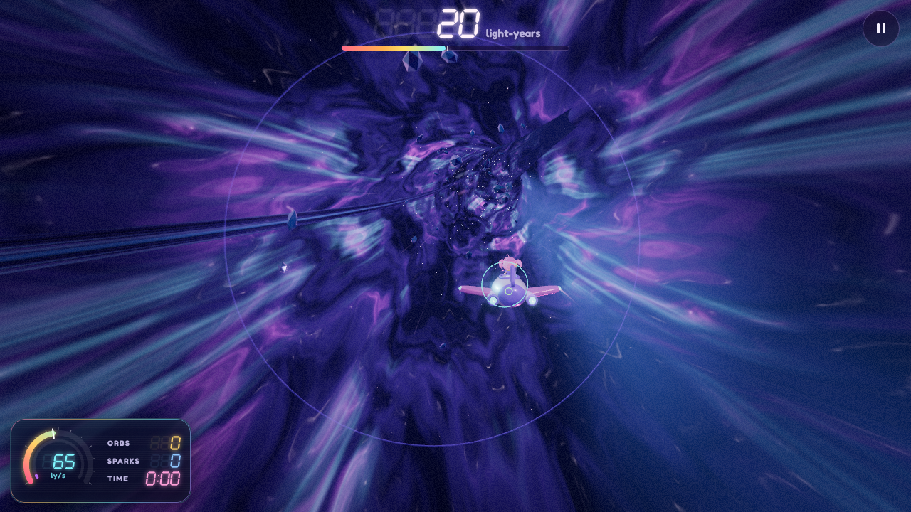
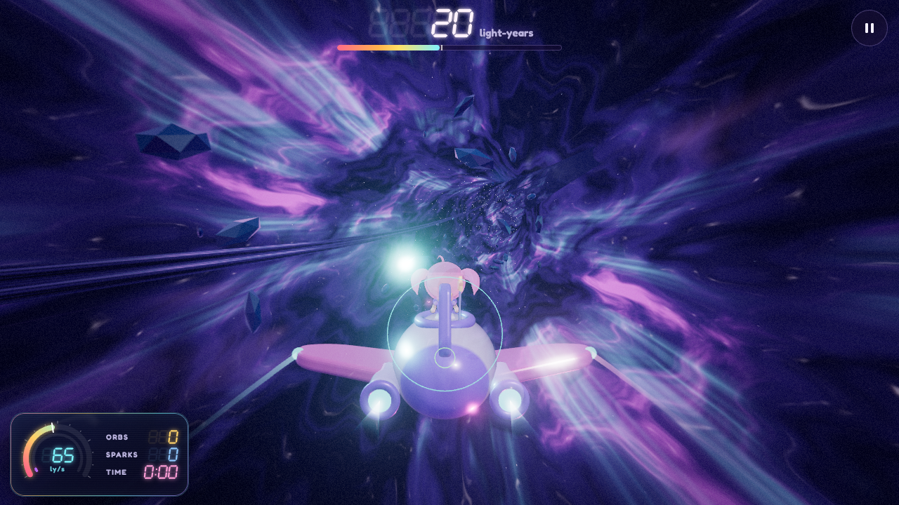
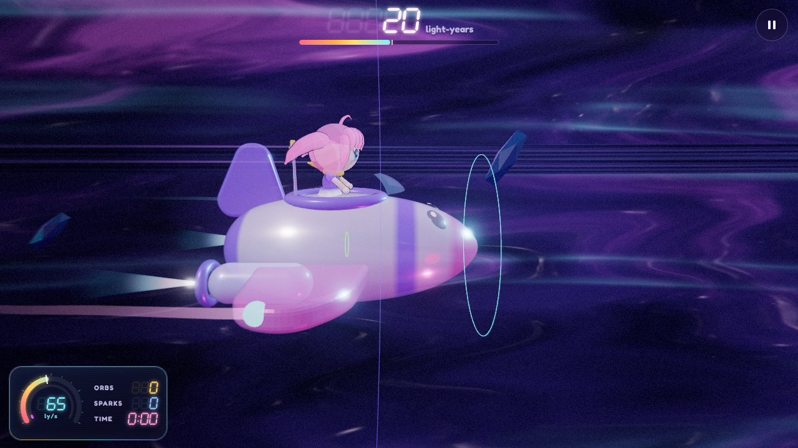
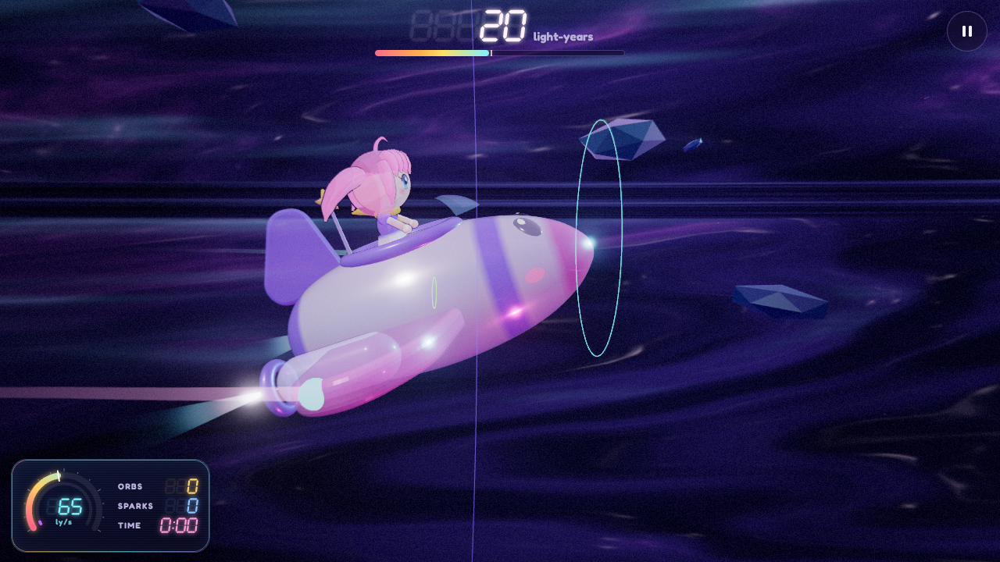
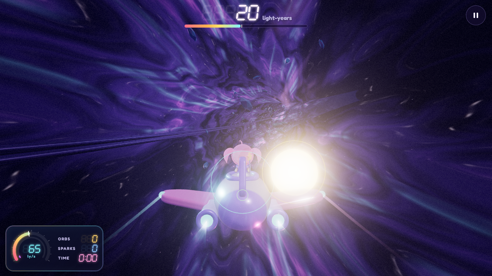
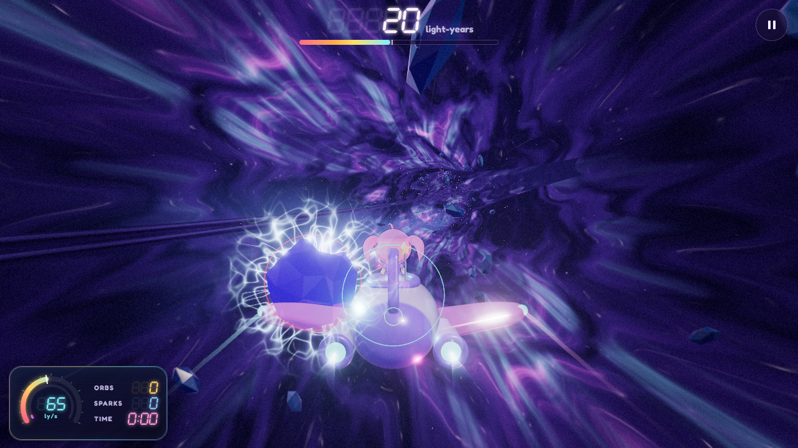
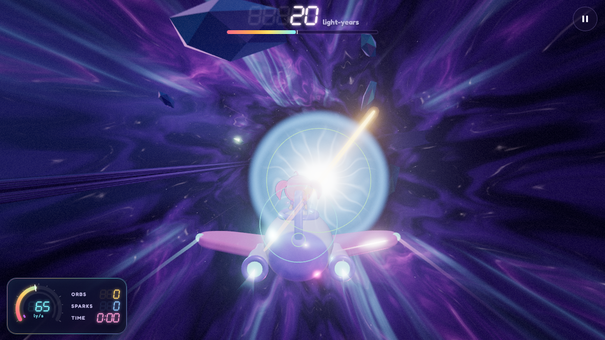
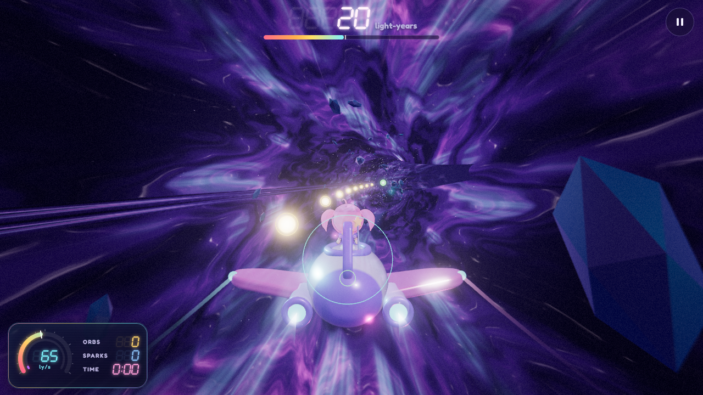

# The hitboxes of a ride

What the rules of a ride (`src/core/ride.ts`) test when the ship meets an orb, a spark or a warp hole, and how that compares with what the 3D view draws. Every size here is in the ride's units: the ship's body is 1.2 wide, the field it flies in 14 across.

To see the hitboxes in the game, switch on **Settings → Show hitboxes in rides**, under Debug log (`src/view/ride/hitboxes.ts`). The view then draws each one as a thin circle in its own color, over everything:

| Color  | Circle                                                                                                  |
| ------ | ------------------------------------------------------------------------------------------------------- |
| Cyan   | The ship's hitbox for orbs and sparks                                                                   |
| Green  | A small mark on the ship's middle, the point warp holes test, and every hole's part that takes the ship |
| Yellow | Every orb                                                                                               |
| Red    | Every spark                                                                                             |
| Violet | The edge of the field the ship's middle stays in                                                        |

## How the rules test

The ride is a straight tunnel. The ship moves across a disc of its cross-section (x to the right, y up), and everything else comes toward it along z, the distance ahead of the ship's middle. So every hitbox is a circle across the tunnel, and a test has two parts:

- **Along the tunnel**: does the thing cross the depth of the ship's hitbox during this simulation step? At speed things move several units per step (0.62 at the starting speed, 120 steps a second), so the test covers the whole stretch the thing travelled in the step (`crossed` in `Ride.#collide`), with the thing's radius as slack on both sides. A thing cannot skip through between two steps.
- **Across the tunnel**: are the circles close enough in x and y at that moment?

| Thing                     | Shape                                         | Size (`RIDE`)                    | When it counts                                                                                                                                                                                                                                                                                                                                                                                                                                                                |
| ------------------------- | --------------------------------------------- | -------------------------------- | ----------------------------------------------------------------------------------------------------------------------------------------------------------------------------------------------------------------------------------------------------------------------------------------------------------------------------------------------------------------------------------------------------------------------------------------------------------------------------- |
| Ship, for orbs and sparks | circle at the tip of its nose (`Ride.hitbox`) | `shipRadius` 0.85                | The tip sits `noseReach` 1.26 ahead of the middle and leads the way: the nose turns toward the sideways speed (`noseTurn` 0.012 rad per unit per second) and tips up and down a little behind the speed up and down (`noseTip` 0.025, at most `maxTip` 0.35 rad), so climbing at full lean lifts the circle by about 0.4. With **Settings → Controls → Ship's hitbox for orbs and sparks at the tip of its nose** switched off, the circle sits at the ship's middle instead. |
| Ship, for holes           | its middle, a point                           | –                                | Whatever the setting. The nose reaches a hole's depth 1.26 sooner and leans toward where the ship heads, so a hole tested there would take the ship sooner; tested at the middle, holes are a little easier to steer clear of.                                                                                                                                                                                                                                                |
| Orb                       | circle                                        | `orbRadius` 0.8                  | Taken when the circles overlap, the middles less than 0.85 + 0.8 = 1.65 apart, while the orb crosses the hitbox's depth within ±0.8. Each one counts once.                                                                                                                                                                                                                                                                                                                    |
| Spark                     | circle                                        | `sparkRadius` 0.75               | Hits when the middles are less than 0.85 + 0.75 = 1.6 apart while it crosses within ±0.75. It costs `sparkLoss` 0.22 of speed and stuns the ship for `stunTime` 0.7 s; for `shieldTime` 1.2 s after a hit no spark hits.                                                                                                                                                                                                                                                      |
| Warp hole                 | circle at 80 % of the hole's radius           | `hole.radius × holeInside` (0.8) | The radius grows with the tier, 2.4 + 0.3 × tier: 2.7 to 3.6, so the circle is 2.16 to 2.88. The ship enters when its middle is inside the circle as the hole crosses the middle's depth. A hole that has captured the ship takes it in wherever it is.                                                                                                                                                                                                                       |
| Field                     | circle around the tunnel's middle             | `fieldRadius` 7                  | The ship's middle stays inside; at the edge it slides along.                                                                                                                                                                                                                                                                                                                                                                                                                  |
| Pull of holes             | reach ahead                                   | `pullRange` 110                  | Below `safeSpeed` 1.2, holes within reach pull at the ship, harder the slower it is and the closer the hole. Below `captureSpeed` 0.55 the next hole captures it.                                                                                                                                                                                                                                                                                                             |

## Screenshots

`tests/screenshots/hitboxes.spec.ts` takes these pictures, and `pnpm screenshots` takes them again with the README's. It stops the ride's simulation and puts the ship and the things where each picture needs them, so every picture shows the moment it is about, while the view goes on drawing. Graphics quality is High, so the ship is a little see-through.

### The ship and its field

From far behind: the violet circle is the field the ship's middle stays in, 7 around the tunnel's middle. The tunnel's wall is drawn at 21, three times as far out.

As the player sees it: the cyan circle around the nose is the hitbox for orbs and sparks, a little wider than the ship's body and narrower than its wings. The small green ring below the girl marks the ship's middle, the point holes test.

From the side the circles face along the tunnel and show edge on: the cyan one stands at the tip of the nose, the green mark is the short dash in the middle of the hull, and the violet line is the far edge of the field.

Climbing at full lean, the nose tips up, and the hitbox for orbs and sparks goes with it. The point holes test stays in the middle.

### An orb, a spark and a hole

An orb as the circles overlap at the nose's depth: this step takes it.

A spark as the circles overlap. Its arcs reach more than twice as far as its circle, and they do not hit.

A hole 9 ahead, about to be entered: its green circle, at 80 % of its radius, lies inside the bright disc, and the green mark on the ship's middle is inside the circle. When the hole reaches the middle's depth, it takes the ship.

### The bend

The orbs and the hole all have the same x and y in the rules: a straight line down the tunnel beside the ship. The view draws them along the bent tunnel, curving away to the right, and draws their circles with them.

## How the circles relate to what is drawn

- **The circles stand where the things are drawn.** The view bends the tunnel for the eye only (`src/view/ride/bend.ts`): everything ahead is pushed aside by the bend times the square of its distance over 400, so the way ahead curves while the ship's surroundings stay straight. The circles get the same push, so each sits on its thing, while the rules test them all straight. A thing that looks to lie off to the side far ahead may be straight ahead in the rules; the push fades as it comes near and is gone at the ship. At the nose's depth it is about a hundred-thousandth of the bend, less than a thousandth of a unit.
- **Drawn a little ahead.** The simulation steps 120 times a second and the screen draws as often as it does, so the view draws the ship and the things ahead by the time not yet stepped (`Ride.lag`, less than a step), and the circles with them.
- **The nose as drawn.** The rules keep how far the nose is turned and tipped (`Ship.yaw`, `Ship.pitch`) and the view turns the model by them, so the cyan circle stays on the tip as the ship moves. Two motions of the model are left out: the ship's roll as it banks, which does not move the nose, and its gentle bob of 0.035 up and down.
- **Edge on from the side.** The circles face along the tunnel, as the tests run across it, so from the side they are lines.

## Drawn sizes against hitboxes

Measured from the models in `src/view/models/ship.ts`, `src/view/models/girl.ts` and `src/view/ride/things.ts`, as a basis for tuning.

| Thing     | Drawn                                                                                                                                                                                                                                                                           | Hitbox                                                                          | What it means                                                                                                                                                                                                                                                                                               |
| --------- | ------------------------------------------------------------------------------------------------------------------------------------------------------------------------------------------------------------------------------------------------------------------------------- | ------------------------------------------------------------------------------- | ----------------------------------------------------------------------------------------------------------------------------------------------------------------------------------------------------------------------------------------------------------------------------------------------------------- |
| Ship      | Body 1.2 wide and 1.04 tall, from the nose 1.26 ahead of the middle to the tail 1.12 behind. Engines out to 0.81 to each side, wings out to 1.72 with their lights at 1.64, 1.0 to 1.9 behind the nose. Fin and antenna up to 1.0 above the middle, the girl's head up to 1.25. | Circle of 0.85 at the nose for orbs and sparks; the middle, a point, for holes. | The circle covers the body and the engines, not the wings. But an orb counts with its middle up to 1.65 from the nose, about as far out as the wing lights, and a spark up to 1.6. Everything counts at the nose's depth, before it gets to the girl or the wings, which are 1.2 and 1.0 or more behind it. |
| Orb       | Ball of 0.62, glow out to 1.3                                                                                                                                                                                                                                                   | 0.8                                                                             | A little larger than the ball, well inside the glow.                                                                                                                                                                                                                                                        |
| Spark     | Spiked core out to 0.71, arcs out to 1.7                                                                                                                                                                                                                                        | 0.75                                                                            | About the core with its spikes. The arcs look like they hit from more than twice as far.                                                                                                                                                                                                                    |
| Warp hole | Bright disc fading out between 0.86 and 0.98 of the radius, its edge wobbling by a few percent; dark smoky rim out to about 1.42 (up to 0.35 more while the hole pulls). Halos at 1.3 and 1.62, the flower out to 2.3.                                                          | 0.8 of the radius, tested against the ship's middle                             | A ring of the bright disc, about 0.1 of the radius wide (0.3 to 0.4 units), lies outside the circle: the ship can pass through the bright edge without being taken, and part of its body may be over the disc as long as its middle is not inside the circle.                                               |
| Field     | The tunnel's wall at 21                                                                                                                                                                                                                                                         | 7, for the ship's middle                                                        | The ship never comes near the drawn wall. Orbs appear within 6.5 of the tunnel's middle and holes within 6, so a ship at the edge of its field reaches them all; sparks circle up to 1.8 around points within 6.                                                                                            |
